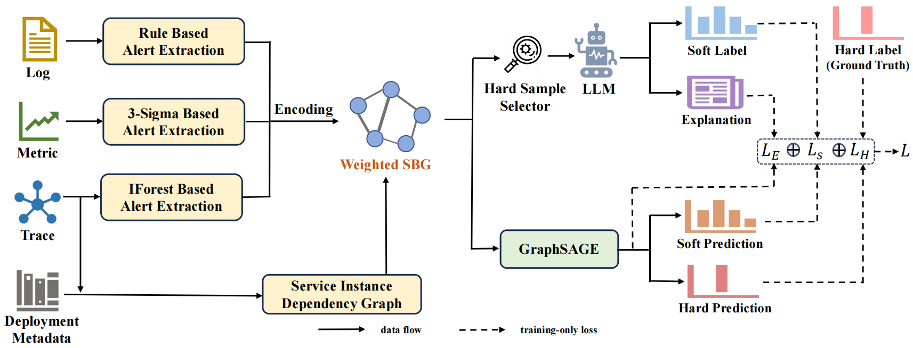

# Progressive Knowledge Distillation from LLMs to GNNs for Multimodal Root Cause Localization

KDRCL is a multimodal root cause localization project for microservice systems. It encodes abnormal events from metrics, traces, and logs into service-instance-level features, and constructs a weighted graph based on service dependencies. The model uses three separate GraphSAGE branches to learn graph representations for different modalities, then fuses them to compute a root cause score for each service instance in the graph.

The current implementation also introduces knowledge distillation for hard samples. During training, it can query a teacher model compatible with the OpenAI Chat Completions API to obtain node-level soft labels and failure explanations. The student model is jointly guided by KL divergence and semantic feature alignment.

## Framework Overview



The overall workflow is as follows:

1. Extract discrete abnormal events from logs, metrics, and traces.
2. Use FastText to encode the three types of events into service-instance-level vectors.
3. Build a Service Behavior Graph based on deployment information and service invocation relationships. The current code further generates normalized edge weights according to the occurrence frequency of abnormal invocations.
4. Use three independent GraphSAGE encoders to process the Metric, Trace, and Log node features in parallel.
5. Concatenate the node representations from the three modalities and output a root cause score for each node through an MLP.
6. For low-confidence hard samples, use a large language model to provide soft labels and explanatory semantics, enabling progressive knowledge distillation and feature alignment.

## Project Structure

```text
KDRCL_main/
├── config/
│   └── exp_config.py          # Dataset, model, distillation, and training parameters
├── core/
│   ├── KDRCL.py               # Training, teacher querying, distillation, evaluation, and model saving
│   ├── multimodal_dataset.py  # Wrapper from multimodal events to DGL graphs
│   └── model/
│       ├── MainModel.py       # Tri-modal encoding, feature fusion, and root cause localization
│       ├── Encoder.py
│       ├── Voter.py
│       └── backbone/
│           ├── sage.py        # GraphSAGE with edge weights
│           └── FC.py          # Fully connected prediction network
├── data/
│   ├── aiops22/
│   ├── gaia/
│   └── sockshop/              # Labels, event JSON files, and precomputed features
├── extractor/                 # Raw telemetry preprocessing and abnormal event extraction code
├── helper/                    # Logging, early stopping, evaluation, and serialization utilities
├── process/
│   ├── EventProcess.py        # Feature reconstruction, weighted graph construction, and dataset building
│   └── events/fasttext_w2v.py # FastText event encoding
├── figure/
│   └── overview.png
├── logs/                      # Logs, TensorBoard events, and model checkpoints
├── main.py                    # Train and evaluate the model
└── test.py                    # Load a checkpoint for testing
```

## Datasets

We conducted experiments on three datasets:

- [GAIA](https://github.com/CloudWise-OpenSource/GAIA-DataSet). GAIA is collected from the MicroSS business simulation system, which contains multiple microservices and middleware components. It provides multi-modal monitoring data, including metrics, traces, and logs. The failures in GAIA are mainly injected at the instance level, such as resource anomalies and service execution failures.
- [AIOps-22](https://competition.aiops-challenge.com). AIOps-22 is derived from the training data of the AIOps 2022 Challenge. It is based on a Web-based e-commerce microservice system and includes faults injected at different levels, including node, service, and instance levels. This dataset is useful for evaluating diagnosis methods under more complex fault propagation scenarios.
- [SockShop](https://github.com/microservices-demo/microservices-demo). SockShop is based on a widely used open-source microservice demo application. The dataset is collected from a containerized microservice environment with injected failures such as resource exhaustion, network degradation, and service-level faults. It provides an additional application scenario with different service dependencies and anomaly patterns.

In our experiments, we use alert-level representations derived from the monitoring data, and each failure case is associated with its corresponding root cause label for quantitative comparison.


## Getting Started

### Environment Requirements

This project is implemented with Python 3.9. All required dependencies are listed in requirements.txt.

You can install them by running:

```text
pip install -r requirements.txt
```

Note that the project uses CUDA 11.8-based versions of PyTorch and DGL. Please ensure that your CUDA environment is compatible before installation.

### Pre-run Configuration

All experiment parameters are centralized in `config/exp_config.py`.

#### 1. Dataset and Feature Cache

`main.py` currently runs `sockshop` by default and sets:

```python
config.reconstruct = False
```

This means that the program directly reads the existing features for the three modalities from `data/<dataset>/tmp/`. If it is set to `True`, the program retrains FastText based on `raw/*.json` and the training labels, and overwrites the following generated feature files:

```text
data/<dataset>/tmp/metric.pkl
data/<dataset>/tmp/trace.pkl
data/<dataset>/tmp/log.pkl
```

If it is set to:

```python
config.reconstruct = True
```

The program retrains FastText based on `raw/*.json` and the training labels, then overwrites the feature files listed above.

#### 2. Teacher Model

If knowledge distillation is enabled, confirm the following parameters in `config/exp_config.py` before running the project:

```python
distillation = True
teacher_model = "<model-name>"
teacher_api_key = "<your-api-key>"
teacher_base_url = "<openai-compatible-base-url>"
```

The teacher service must be compatible with `chat.completions.create` and must return JSON containing `logits` and `overall_explanation` according to the prompt. Teacher queries will incur network requests, latency, and possible API costs.

To run only the basic supervised model, disable the following options:

```python
distillation = False
hard_sample_distill = False
feature_alignment = False
```


#### 3. BERT Path

When `feature_alignment` is enabled, `core/KDRCL.py` loads `bert-base-uncased` from the local directory specified in the current code. It is used to semantically encode teacher explanation texts and align them with the student model features.

Before running the project, make sure that the directory exists, or modify the path in the code to point to your local model directory. The directory must contain the complete BERT model files.

Note: Although `test.py` disables teacher distillation, it still sets `feature_alignment` to `True`. Therefore, the local BERT model will also be initialized during testing.

To enable semantic feature alignment, first download or prepare a local model directory, for example:

```text
/bert-base-uncased/
├── config.json
├── pytorch_model.bin
├── tokenizer.json
├── tokenizer_config.json
└── vocab.txt
```

Then modify the BERT path in the code to this directory.

### Training and Evaluation

Run the following command in the project root directory:

```bash
python main.py
```

To switch datasets, modify the dataset list in `main.py`. `Config` currently supports:

```text
gaia
aiops22
sockshop
```

During training, the program reads data, builds multimodal graphs, trains the model, and performs evaluation according to the configuration. Logs, TensorBoard events, and model checkpoints are saved to `logs/<dataset>/` by default.

### Testing an Existing Model

After confirming that `logs/<dataset>/KDRCL.pt` exists, run:

```bash
python test.py
```

During testing, the model structure configuration must be consistent with the configuration used when saving the checkpoint. Otherwise, `load_state_dict` will fail due to mismatched parameter shapes or keys.

## Main Configuration Items

| Parameter | Default Value | Description |
| --- | ---: | --- |
| `modalities` | `metric, trace, log` | Event modalities used by the model |
| `alert_embedding_dim` | `128` | FastText node feature dimension |
| `graph_hidden_dim` | `64` | GraphSAGE hidden dimension |
| `graph_out` | `32` | Output dimension of each single-modality graph encoder |
| `graph_layers` | `2` | Number of GraphSAGE layers |
| `batch_size` | `128` | Training batch size |
| `epochs` | `100` | Maximum number of training epochs |
| `lr` | `0.001` | Adam learning rate |
| `weight_decay` | `0.0001` | Weight decay |
| `hard_threshold` | `0.3` | Confidence threshold for hard samples |
| `distill_temperature` | `5.0` | Distillation temperature |
| `distill_alpha` | `0.2` | Weight of the distillation loss |
| `alignment_weight` | `0.1` | Weight of the semantic alignment loss |
| `initial_teacher_ratio` | `0.5` | Initial teacher sample ratio |
| `final_teacher_ratio` | `0.1` | Final teacher sample ratio |
| `teacher_annealing_epochs` | `10` | Number of epochs for teacher ratio annealing |
